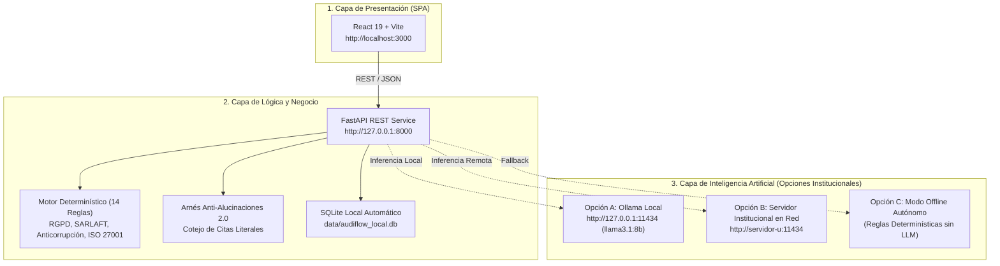

# Manual Institucional de Despliegue, Ejecución y Conexión de Servidor Propio

**Plataforma Audiflow — Sistema Experto de Inspección y Auditoría Legal**  
*Proyecto de Grado para Titulación Profesional en Ingeniería de Software*  
*Corporación Universitaria del Caribe (Unicaribe) — Noviembre 2026*

---

## 📌 1. Información General y Aviso de Servidor

| Parámetro | Detalle Institucional |
| :--- | :--- |
| **Proyecto** | Audiflow — Asistente de Auditoría Contractual con IA y Reglas Normativas |
| **Autores** | Eduardo Pedroza Jiménez, Antonio Manuel Guerrero, Daysmir Hugueth |
| **Director / Asesor** | PhD Jorge Rudas |
| **Repositorio** | [https://github.com/Eduarpj97/asistente-auditoria](https://github.com/Eduarpj97/asistente-auditoria) |
| **Licencia / Uso** | Académico / Evaluación Institucional Unicaribe |

> [!IMPORTANT]
> **Aviso de Servidor de Inferencia**:  
> Durante la etapa de investigación y sustentación, el motor Llama 3.1 8B operó en una VPS personal de Oracle Cloud. Dicho servidor ha sido **apagado tras la sustentación**. El sistema está 100% desacoplado y preparado para que la institución conecte su propio servidor Ollama (local o en red) o utilice el modo autónomo determinístico sin depender de servidores externos.

---

## 🏗️ 2. Arquitectura de Despliegue Institucional



---

## ⚙️ 3. Opciones de Ejecución del Motor de IA

### Opción A (Recomendada): Ollama Local en el Equipo del Evaluador
1. **Descargar e instalar Ollama**:
   Visite [https://ollama.com/download](https://ollama.com/download) e instale Ollama para su sistema operativo.
2. **Descargar el modelo**:
   ```bash
   ollama run llama3.1:8b
   ```
   *(Si el equipo no cuenta con tarjeta gráfica dedicada, puede usar el modelo ultra-liviano `ollama run llama3.2:3b`)*.
3. **Verificar estado**:  
   Abra en el navegador `http://127.0.0.1:11434` — Debe responder `"Ollama is running"`.
4. El archivo `.env` del proyecto ya viene preconfigurado apuntando a este endpoint.

### Opción B: Servidor Ollama en Red Institucional
Si la universidad dispone de un servidor GPU en red local o nube:
1. En el archivo `.env`, configure:
   ```env
   OLLAMA_BASE_URL=http://<IP_O_DOMINIO_DEL_SERVIDOR>:11434
   OLLAMA_MODEL=llama3.1:8b
   ```

### Opción C: Modo de Contingencia Autónomo (Sin Servidor de IA)
Audiflow **no colapsa si el servidor LLM está apagado**. Cuenta con un motor de scoring en Python que ejecuta 14 reglas normativas de cumplimiento, extrae el texto, computa el semáforo y emite el dictamen preliminar en modo offline.

---

## 🚀 4. Guía de Puesta en Marcha Paso a Paso

### 4.1 Backend (FastAPI)
```bash
# 1. Acceder al directorio del backend
cd api

# 2. Crear entorno virtual (opcional pero recomendado)
python -m venv venv

# En Windows:
.\venv\Scripts\Activate.ps1
# En Linux/macOS:
source venv/bin/activate

# 3. Instalar dependencias
pip install -r requirements.txt

# 4. Iniciar el servicio
python main.py
```
- **Backend disponible en**: `http://127.0.0.1:8000`
- **Swagger UI interactivo**: `http://127.0.0.1:8000/docs`
- **Diagnóstico del sistema**: `http://127.0.0.1:8000/v1/health`

### 4.2 Frontend (React 19 + Vite)
```bash
# En una segunda terminal:
cd frontend

# Instalar paquetes
npm install

# Iniciar servidor de desarrollo
npm run dev
```
- **Panel Web interactivo**: `http://localhost:3000`

### 4.3 Despliegue con Docker (1 Comando)
```bash
docker-compose up -d --build
```
- **Acceso web producción**: `http://localhost:8080`

---

## 💾 5. Base de Datos y Persistencia
- **SQLite Local Automático**: Los contratos auditados, usuarios y registros se almacenan en `data/audiflow_local.db`. No requiere internet ni configuración adicional.
- **Supabase Opcional**: Si la universidad cuenta con un entorno Supabase, puede configurarlo en `.env` mediante `SUPABASE_URL` y `SUPABASE_PUBLISHABLE_KEY`.

---

## 🧪 6. Contratos de Muestra y Pruebas de Calidad

### Muestras incluidas en el proyecto:
- `data/samples/contrato_auditoria_muestra.pdf`: Contrato de servicios con cláusulas desproporcionadas y ausencia de cláusula de Habeas Data.
- `data/samples/contrato_sla_software.txt`: Acuerdo SLA con exclusión de culpa grave.

### Ejecución de Pruebas Automatizadas (100% Passed):
```bash
# Backend (19 tests unitarios Pytest)
pytest api/test_risk_engine.py -v

# Frontend (4 tests de componentes Vitest)
cd frontend && npm run test:components

# Pruebas End-to-End (3 flujos completos con Playwright)
cd frontend && npm run test:e2e
```

---

## 👨‍💻 Autores y Contacto
- **Eduardo Pedroza Jiménez, Antonio Manuel Guerrero, Daysmir Hugueth**
- **Ingeniería de Software — Corporación Universitaria del Caribe (Unicaribe)**
- Repositorio GitHub: [https://github.com/Eduarpj97/asistente-auditoria](https://github.com/Eduarpj97/asistente-auditoria)
